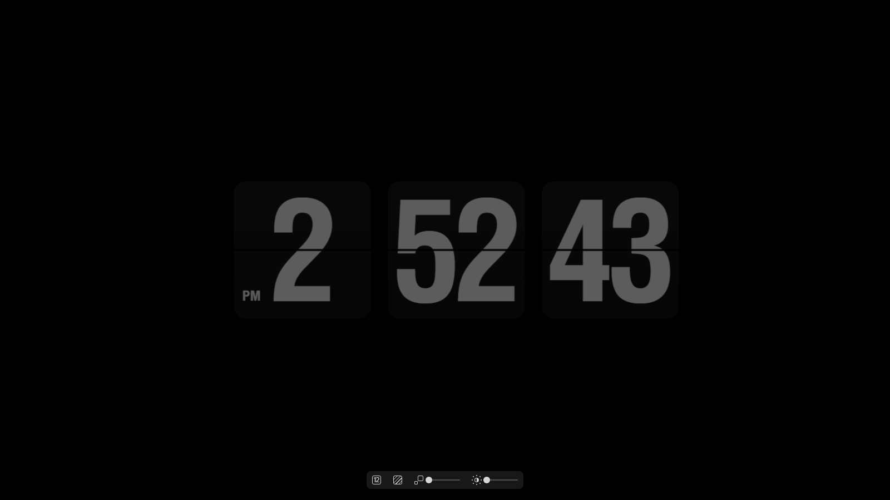

# Fliqlo 网页版（浏览器全屏时钟）

从 **Fliqlo 1.6.1 for Windows** 的 `Fliqlo.scr` 里提取的翻页时钟页面，并补上了显秒和设置栏。
双击用浏览器打开、按 F11 全屏，就可以长期当屏保用——**鼠标怎么动都不会退出**，这是它和原版 `.scr` 最大的区别。



## 文件

| 文件 | 说明 |
|---|---|
| `fliqlo.html` | 主页面，单文件（CSS / JS / WOFF2 字体全部内联），双击即可打开 |
| `assets/img1.png` | README 效果图 |
| `Fliqlo.ico` | 安装包与快捷方式图标 |
| `installer/Fliqlo.iss` | Inno Setup 安装脚本 |

## 功能

- **时:分 / 时:分:秒 两种形态**：小时格式下拉里的 `+S` 三项就是显秒模式
- **设置栏常驻可用、自动隐藏**：鼠标移动时出现在屏幕底部，停 3 秒淡出
- 三种小时写法（`1-12 AM/PM` / `00-23` / `0-23`）、AM/PM 角标、翻片底板、缩放 50–100、亮度 50–100
- 横竖屏自动重排；三卡模式在 16:9 屏上整体缩到约 82%
- 零外部请求：字体是 base64 内嵌，CSS/JS 全在一个文件里，不联网
- 翻页动画沿用原版：165ms 的 CSS 3D 翻转

## 使用

1. 双击 `fliqlo.html`（默认浏览器打开）
2. 按 **F11** 全屏；再按一次退出
3. 设置栏在屏幕底部：移动鼠标出现，停 3 秒自动隐藏；改动即时生效并记在浏览器里
4. 想临时固定形态：`fliqlo.html?ss=0`（时:分）或 `?ss=1`（时:分:秒），只对本次打开生效

> 双击打开的是普通标签页（带地址栏），F11 之后就是纯时钟；鼠标移动、点击都不会让它消失。

## 安装包

脚本 `installer/Fliqlo.iss`，用 Inno Setup 6.6.1 编译：

```powershell
& "D:\Inno Setup 6.6.1\ISCC.exe" installer\Fliqlo.iss
```

- 产物：`installer\Output\Fliqlo-Setup-1.6.1.exe`
- 安装位置：`%LOCALAPPDATA%\Programs\Fliqlo`（每用户安装，不需要管理员）
- 快捷方式：桌面 / 开始菜单，名称 **Fliqlo**，图标 `Fliqlo.ico`（安装向导里「创建桌面快捷方式」默认勾选）
- 卸载：删除安装目录和快捷方式；浏览器 localStorage 里的设置不会动

## 实现说明

### 为什么原版不能直接双击

原版页面跑在 WebView2 里，靠 `window.chrome.webview.postMessage` 和宿主通信。用 `file://` 打开时
`location.hostname` 是空串，而 Chrome/Edge 又确实有 `window.chrome` 对象，`isChrome` 被误判成 `true`，
接着访问不存在的 `window.chrome.webview.addEventListener` 抛 TypeError，整段脚本中断 → 只剩黑屏。

修补了 3 处：`isChrome` 改判为“必须存在 `chrome.webview`”、`appStorage` 的 `postMessage`/`addEventListener`
加存在性检查、`isConfig` 直接置真（设置栏常开）。修补后走浏览器自己的 `localStorage`。
三处在文件里分别以 `PATCH1` / `PATCH2` / `PATCH3` 标注，升级原版时搜这三个词即可定位。

### 显秒是怎么做的

原版只有「时 / 分」两张卡片。这里加了第三张 `.flips#secs`，布局规则全部挂在 `body.secs-on` 下，
只在该状态下把容器从 1350×700 扩到 1950×700（竖屏 700×1950）。

小时格式下拉从 3 项扩成 6 项，选中 `+S` 时给 `body` 加类、广播 `_resize` 重算缩放；
秒卡由一段独立脚本按 175ms 定时器驱动，复用原版 `act/transform` 与 `fadein/fadeout1` 的 class 流程，
完全不碰原版时/分逻辑。切换格式后会把 `dsptf` 置空，强制小时卡立即按新格式重绘——
原版这里要等到下一个整点才刷新。

### 兼容性

- 在 Edge（150+）上实测渲染与切换均正常；Chrome 同内核，理论一致
- Firefox 没有 `window.chrome`，`isChrome` 恒为 false，理论上同样可用（未实测）

## 设置项

| key | 含义 | 取值 |
|---|---|---|
| `tf` | 时间格式 | `0`=1-12 AM/PM，`1`=00-23，`2`=0-23；下拉框的 `3/4/5` 是对应的 `+S` |
| `bg` | 翻片底板 | `1` / `0`（旧版本存的 `true` / `false` 仍能正确读取） |
| `br` | 亮度 | 50–100 |
| `sc` | 缩放 | 50–100 |
| `ss` | 显秒 | `1` / `0` |

存储位置是浏览器的 `localStorage`，按页面来源隔离（`file://` 与 `http://localhost` 是两套）。
和原版 `.scr` 用的 `%LOCALAPPDATA%\Fliqlo\webview-storage.json` **互不相通**。

## 注意

- 网页无法阻止系统按电源计划关闭显示器或进入睡眠；要常亮请把“关闭屏幕/睡眠”设为“从不”
- 全屏下光标默认可见；想隐藏可以另存一份，把 CSS 里的 `cursor:default` 改成 `cursor:none`
- 这是非官方重打包：页面与字体的版权归原作者 Yuji Adachi / 9031(https://fliqlo.com/)
