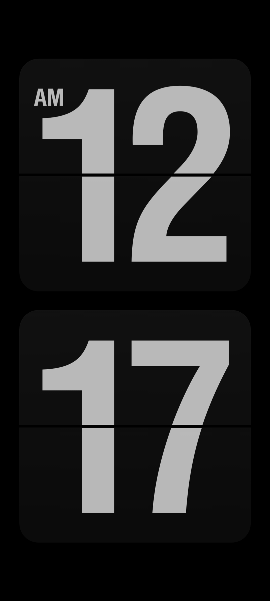
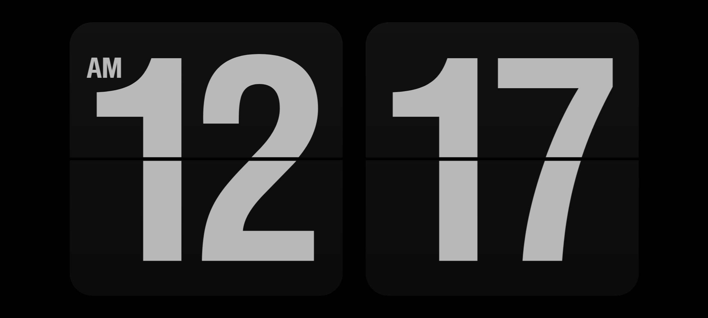

# Fliqlo · Android 版

[**Windows**](/windows/README.md) | [**总览**](/README.md) | Android


把 `web/fliqlo.html` 包成一个原生 Android App。页面完全打进 APK 的 `assets/`，
**运行时不联网、不依赖任何服务器**，启动即显示，飞行模式下照常使用。

| 竖屏（时:分） | 横屏（时:分） |
|---|---|
|  |  |

## 概览

| 项目 | 版本 / 位置 |
|---|---|
| 包名 | `com.fliqlo.clock` |
| Android Studio | 2026.2.2 · `D:\Android Studio`（JBR 25） |
| Android SDK | `D:\Android\Sdk`（platform-tools 37.0.1 / platforms;android-36 / build-tools;36.0.0） |
| Gradle / AGP | 9.8.2 / 9.5.0 |
| compileSdk / targetSdk / minSdk | 36 / 36 / 24 |
| 产物 | `app/build/outputs/apk/release/Fliqlo-release.apk`（约 0.65 MB，发行版） |

## 使用

装到手机（手机插 USB、开 USB 调试）：

```bash
"D:\Android\Sdk\platform-tools\adb.exe" install -r app\build\outputs\apk\release\Fliqlo-release.apk
```

或者把 `Fliqlo-release.apk` 拷到手机点开安装，允许一次「未知来源」即可。

打开后就是全屏时钟：常亮不休眠、随手机自动横竖屏，按返回键不会退出（躺着看时不易误触），
要离开按 Home 键。

## 构建

命令行（首次约一分半，之后几秒）：

```bash
cd android
export JAVA_HOME="D:\Android Studio\jbr"
export ANDROID_HOME="D:\Android\Sdk"
./gradlew assembleRelease
```

产物是发行版（release）。自用 App，`build.gradle` 里 release 直接复用 debug 签名，
不需要另外生成 keystore。

**Android Studio**：`File → Open` 选 `android/` 目录。`local.properties` 里已经写好
`sdk.dir=D:\Android\Sdk`，打开就能同步，不会再弹下载 SDK 的向导。

### Gradle 分发包使用镜像

`gradle-wrapper.properties` 里的 `distributionUrl` 指向**华为云镜像**。
官方地址 `https://services.gradle.org/distributions/gradle-x.x.x-bin.zip` 会重定向到
GitHub Releases，部分网络环境访问不到，Gradle 会卡在下载阶段。如果所在网络可以直连官方，
把 `distributionUrl` 换回 `https://services.gradle.org/distributions/gradle-9.8.2-bin.zip` 即可。

Android Studio 的 HTTP Proxy 保持 **No proxy**（本工程的依赖源均可直连）。

### 改页面之后要同步

`app/src/main/assets/index.html` 是从 `web/fliqlo.html` 生成的副本，**不要直接改它**。
改了 `web/fliqlo.html` 后跑一次：

```bash
python android/tools/sync_asset.py
```

脚本同时保证：首次运行（`localStorage` 里还没有设置）时，缩放与亮度按默认值 100 初始化。

## 实现要点

`MainActivity.java` 的关键设置及各自的作用：

| 设置 | 作用 |
|---|---|
| 页面放在 `assets/`，用 `file:///android_asset/` 加载 | 页面随包分发，不依赖网络，飞行模式也能用 |
| `setLoadWithOverviewMode(false)` | 禁用 WebView 对页面的二次缩放，页面按自身 `scale()` 呈现 |
| `setTextZoom(100)` | 文字缩放固定为 100%，显示不随系统字体大小变化 |
| 真全屏且不给 WebView 加内边距 | CSS 视口严格等于屏幕，`scale()` 的 transform-origin 正好落在屏幕中心 |
| `windowBackground` 纯黑 | 启动画面与页面底色一致；配合 `FLAG_KEEP_SCREEN_ON` 当床头钟用 |

APK **不申请任何权限**（不含 `INTERNET`），物理上无法联网。

## 常见问题

**想让默认不显示秒**
`web/fliqlo.html` 里秒针驱动那段的 `var KEY="ss", enabled=true` 改成 `false`，再跑一次同步脚本。
或者临时打开 `index.html?ss=0`（只对当次生效）。

**想改名字 / 图标**
名字改 `app/src/main/res/values/strings.xml`，图标替换
`app/src/main/res/mipmap-xxxhdpi/ic_launcher.png`（只要一张 192 或 256 px 的方形 PNG）。

**Gradle 报 download timeout**
见上节「Gradle 分发包使用镜像」，把 `distributionUrl` 换成所在网络可达的镜像。

**装的时候提示 INSTALL_FAILED_UPDATE_INCOMPATIBLE**
手机上装过同包名的旧版且签名不同，先卸载：`adb uninstall com.fliqlo.clock`。
