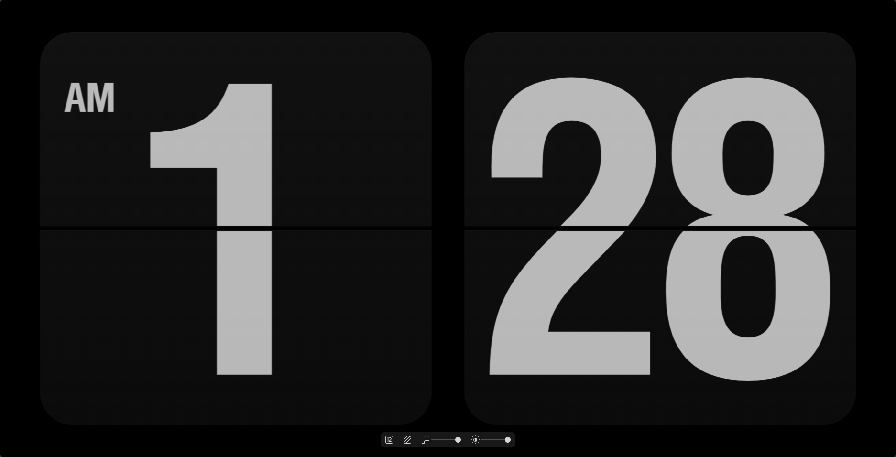

# Fliqlo · Windows 版

Windows | [**总览**](/README.md) | [**Android**](/android/README.md)


页面本体在 [`../web/fliqlo.html`](../web/fliqlo.html)，Windows 这边只负责两件事：
**怎么打开它**，以及**怎么把它打成安装包**。

 

## 概览

| 项目 | 版本 / 位置 |
|---|---|
| 安装包脚本 | `windows/Fliqlo.iss`（Inno Setup 6.6.1） |
| 产物 | `windows/Output/Fliqlo-Setup-1.0.exe`（约 2.3 MB） |
| 安装位置 | `%LOCALAPPDATA%\Programs\Fliqlo`（每用户安装，不需要管理员） |
| 运行时依赖 | 无，只需要一个浏览器 |

没有构建步骤——`.iss` 安装时直接引用 `..\web\fliqlo.html`，改完页面重新编译一次安装包就是最新的。

## 使用

1. 双击 `web\fliqlo.html`，默认浏览器打开
2. 按 **F11** 全屏，再按一次退出
3. 设置栏在屏幕底部：移动鼠标出现，停 3 秒自动隐藏；改动即时生效并记在浏览器里
4. 想临时固定形态：`fliqlo.html?ss=0`（时:分）或 `?ss=1`（时:分:秒），只对本次打开生效

> 双击打开的是普通标签页（带地址栏），F11 之后就是纯时钟；鼠标移动、点击都不会让它消失——
> 这是它和原版 `.scr` 最大的区别。

全屏下光标默认可见。想隐藏的话，另存一份把 CSS 里的 `cursor:default` 改成 `cursor:none`。

## 构建

用 Inno Setup 6.6.1 编译 `Fliqlo.iss`：

```powershell
& "D:\Inno Setup 6.6.1\ISCC.exe" windows\Fliqlo.iss
```

- 产物：`windows\Output\Fliqlo-Setup-1.0.exe`
- 快捷方式：桌面 / 开始菜单，名称 **Fliqlo**，图标 `Fliqlo.ico`（安装向导里「创建桌面快捷方式」默认勾选）
- 卸载：删除安装目录和快捷方式；浏览器 localStorage 里的设置不会动

## 实现要点

### 安装包里其实只有两个文件

`fliqlo.html`（来自 `..\web\`）和 `Fliqlo.ico`（来自项目根目录）。
没有 exe、没有运行库、没有右键菜单钩子——双击快捷方式等于双击那个网页。

### 为什么不打包成一个 exe

原版 `.scr` 是 WebView2 宿主，自带窗口和「鼠标不动才显示」的逻辑。这里刻意不复制那套：
用系统浏览器打开一个本地网页，双击就走，不需要任何运行时依赖，代价是全屏要手动按 F11。

## 常见问题

**按 F11 没反应**
先点一下页面让它拿到焦点。某些笔记本需要 `Fn + F11`，或者用浏览器的全屏菜单。

**换了浏览器设置就没了**
设置存在浏览器自己的 `localStorage` 里，按页面来源隔离。Edge 和 Chrome 各存各的，
`file://` 和 `http://localhost` 也是两套——这是浏览器的标准存储隔离行为。

**卸载后重新装，设置还在**
同上，设置不在安装目录里，安装包也不会去动浏览器数据。

**浏览器兼容性**

- **Edge 150+**：实测渲染与切换均正常
- **Chrome**：同内核，理论一致（未单独实测）
- **Firefox**：没有 `window.chrome`，`isChrome` 恒为 false，理论上同样可用（未实测）
